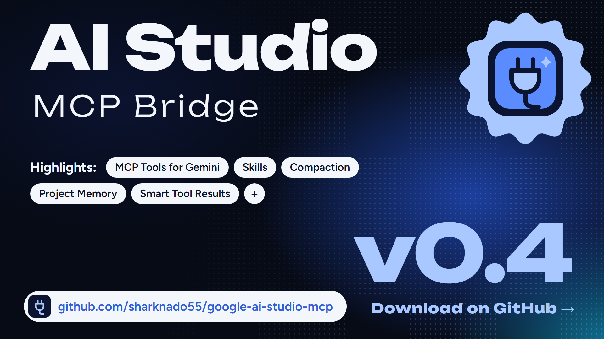

# AI Studio MCP Bridge

A Chrome extension that lets Gemini in [Google AI Studio](https://aistudio.google.com)
use MCP servers: read and write files, drive Roblox Studio or Blender, call any MCP tool.
It also adds the things a coding agent needs for long work: skills, project memory,
compaction and compressed tool results.

Every tool call waits for your approval, and you press Run yourself, unless you choose
otherwise in settings.

## Contents

- [Features](#features)
- [Install](#install)
- [Using it](#using-it)
- [Settings](#settings)
- [Server config reference](#server-config-reference)
- [How tool calls work](#how-tool-calls-work)
- [Safety and your Google account](#safety-and-your-google-account)
- [Limits](#limits)
- [Development and tests](#development-and-tests)

## Features

| Feature | What it does |
| --- | --- |
| **MCP tools** | Local stdio servers (through the bundled bridge) and remote Streamable HTTP servers. |
| **Approval dialog** | Shows each call with editable arguments: Approve, Always allow this tool, or Deny. |
| **Small tool prompt** | One line per tool. Gemini fetches full schemas with `_meta.describe` and finds tools with `_meta.search`. |
| **Reliable calls** | Calls are read from code blocks only, so `_`, `*`, `\` and multi-line code arrive exactly as written. Badly formatted calls are reported back to Gemini. |
| **Several calls per reply** | Up to 5 independent calls in one reply; results go back in one message. |
| **Tool-result compression** | Long results are shortened; Gemini reads the rest with `_meta.retrieve`. |
| **Compaction** | Summarizes a long chat and starts a new one with the summary ready to send. |
| **Skills** | Import skill folders (`SKILL.md` plus reference files). Gemini loads one when a task matches. |
| **Project memory** | Facts saved per project and included in every new chat. Gemini can ask to add one. |
| **Faster long chats** | Off-screen messages are skipped when the page draws, so 100k+ token chats stay responsive. |
| **Auto-approve options** | Optional: read-only tools, a per-tool list, or every tool. |

## Install

Get the code: download the [latest release zip](https://github.com/sharknado55/google-ai-studio-mcp/releases/tag/zip)
and unzip it, or clone the repo.

### 1. Load the extension

1. Open `chrome://extensions` and turn on **Developer mode** (top right).
2. Click **Load unpacked** and select the `extension` folder.
3. Updating later: replace the files, then press the reload button on the extension's card.

### 2. Start the bridge (only for local servers)

Local MCP servers speak over stdio, which a browser cannot reach. The bridge runs them and
exposes each one at `http://127.0.0.1:3939/mcp/<name>`. It needs Node 18 or newer.

```
cd bridge
cp servers.example.json servers.json
node bridge.js
```

On Windows, use `copy` instead of `cp`. Edit `servers.json` to list your servers:

```json
{
  "mcpServers": {
    "files": {
      "command": "npx",
      "args": ["-y", "@modelcontextprotocol/server-filesystem", "C:/Users/you/Projects"]
    }
  }
}
```

Write Windows paths with forward slashes (`C:/Users/you`) or doubled backslashes
(`C:\\Users\\you`). A single backslash is invalid JSON. Each server can also take `cwd` and
`env`. Keep the bridge window open while you use AI Studio. Run
`node bridge.js path/to/other.json` to use another config, or set `PORT` to change the port.

### 3. Add your servers to the extension

Click the extension's toolbar icon to open settings, then enter one entry per server:

```json
{
  "servers": [
    { "name": "files", "url": "http://127.0.0.1:3939/mcp/files" },
    { "name": "remote", "url": "https://example.com/mcp", "headers": { "Authorization": "Bearer TOKEN" } }
  ]
}
```

For a local server, use the same name as in `servers.json`. Press **Save** (Chrome asks
for access to remote addresses), then **Test saved servers**.

## Using it

1. Open a chat in AI Studio and click the **MCP** pill at the bottom right.
2. Choose **Insert tools, skills and memory**. This adds the tool list, rules, your
   skills and the active project's memory to the message box. The pill shows its size.
3. Type your task below it and press **Run**. For a whole chat, you can paste the same
   text into System instructions instead.
4. When Gemini calls a tool, the approval dialog opens. Approve it, and the result goes
   into the message box. Press **Run** and Gemini continues.

### Compaction

When a chat gets long:

1. Click **MCP**, then **Compact this chat**. A summary request goes into the box. Press **Run**.
2. Gemini replies with a summary, and a dialog shows it: **Dismiss**, **Copy** or **Open new chat**.
3. **Open new chat** starts a fresh chat with the tools, skills, memory and summary already
   in the box. Press **Run** to continue where you left off.

### Skills

A skill is a folder with a `SKILL.md` and optional reference files:

```
my-skill/
  SKILL.md              <- header with name and description, then instructions
  references/guide.md   <- opened only when the instructions point to it
  scripts/check.py
```

```markdown
---
name: my-skill
description: Use when building X. Covers Y and Z.
---
Instructions for Gemini...
```

- In settings, click **Import skill folder** and pick one skill's folder, or a parent folder
  that holds many skills. Each folder with a `SKILL.md` becomes a skill.
- Text files up to 1 MB are kept. Images, binaries and hidden folders such as `.git` are skipped.
- Importing a skill again replaces it. **Import single SKILL.md files** imports files without folders.
- Only names and descriptions go into the inserted text, so many skills stay cheap. When a
  task matches a description, Gemini loads the skill with `_meta.skill`. That also lists its
  files, which Gemini opens on demand, 20,000 characters at a time.
- Gemini picks skills by their `description`, so describe when to use it. To force one, say
  "use the my-skill skill" in your message.

### Project memory

- Pick or create a project in settings (**New project**), then write facts in its memory box.
  Switch projects from the **Project** menu on the MCP pill.
- The active project's memory is part of the inserted text, so every new chat starts with it.
- Gemini can ask to save a fact with `_meta.remember`. It shows in the approval dialog; you
  approve or deny it.

### Tool-result compression

Results longer than 6,000 characters (configurable) are shortened before they reach the
chat. JSON is minified, repeated lines are collapsed, and the start, the end and error
lines are kept. The full result stays in the extension's local storage (the last 20
results). Gemini reads more of it with `_meta.retrieve`, by search words or by character
offset. This happens in your browser and needs no approval.

## Settings

| Setting | Default | Notes |
| --- | --- | --- |
| Always-allowed tools | empty | Tools you approved with "Always allow". Click **Ask again** to remove one. |
| Press Run for me after an approved tool call | off | Sends results automatically instead of leaving them in the box. |
| Allow every tool automatically | off | Skips the approval dialog for every call. Risky: see [Safety](#safety-and-your-google-account). The pill shows `MCP (auto)` while on. |
| Run tools the server marks read-only without asking | off | Uses each tool's `readOnlyHint`. Writes still ask. |
| Speed up long chats | on | Uses `content-visibility` to skip drawing off-screen messages. Turn off if scrolling jumps. |
| Shorten tool results longer than N characters | 6000 | `0` turns compression off. |

Press **Save behaviour** after changing these.

## Server config reference

Each entry in the extension's `servers` list:

| Field | Meaning |
| --- | --- |
| `name` | Letters, digits, `_` and `-`. Gemini calls tools as `name.tool`. |
| `url` | The server's MCP endpoint, or `http://127.0.0.1:3939/mcp/<name>` for a bridge server. |
| `headers` | Optional HTTP headers, such as an API token. |
| `enabled` | `false` hides the server without deleting it. |
| `tools` | Optional allow list of tool names, with `*` wildcards. |
| `hideTools` | Optional deny list, with `*` wildcards. Hidden tools cannot be called. |
| `promptInfo` | Info tools run when you insert the tool list, so Gemini knows their output up front. Defaults to `["list_allowed_directories"]` when the server has it. `[]` turns this off. |

Example that trims a big server:

```json
{ "name": "rea", "url": "http://127.0.0.1:3939/mcp/rea",
  "tools": ["analyze_javascript*", "*electron*"], "hideTools": ["*capture*"] }
```

If the tool list would exceed about 7,500 tokens, the inserted text switches to search
mode: it lists each server's tool count and a few example names, and Gemini finds the rest
with `_meta.search`.

## How tool calls work

Gemini ends its reply with one or more blocks like this, each fence on its own line:

````
```mcp-call
{"mcp_call":{"server":"files","tool":"read_file","arguments":{"path":"C:/notes.txt"}}}
```
````

1. The extension waits until the reply stops changing, then reads the calls from the code blocks.
2. The approval dialog shows each call (editable JSON). Nothing runs until you approve.
3. **Approve** runs it once. **Always allow this tool** also skips the dialog for that tool from
   now on. **Deny** (or Escape) tells Gemini not to retry and skips the remaining calls.
4. The results go into the message box as `MCP RESULT` messages. Press **Run**.

Calls only count in replies that stream in live, so opening an old chat never re-runs its calls.
A call written as plain text instead of a code block is not run. The extension replies with
`MCP FORMAT ERROR` and asks Gemini to resend it. This matters because AI Studio's Markdown
strips `_`, `*` and `\` from plain text, which would silently corrupt code.

Built-in `_meta` tools:

| Tool | Purpose | Approval |
| --- | --- | --- |
| `_meta.describe` | Full description and input schema of tools | none |
| `_meta.search` | Find tools by words | none |
| `_meta.retrieve` | Read more of a shortened result | none |
| `_meta.skill` | Load a skill or one of its files | none |
| `_meta.remember` | Save a fact to project memory | asks |

## Safety and your Google account

- **Nothing extra goes to Google.** The extension calls no Google APIs and makes no
  background requests. Compression, skills, memory and compaction all run in your browser.
  Google only sees the messages you send.
- **You press Run by default.** Results and summaries go into the message box. Nothing is
  sent automatically unless you turn on auto-send.
- **Tool results become part of your chat with Google.** Only connect tools whose output you
  are fine sending.
- **Prompt injection.** A web page or file that Gemini reads can contain instructions. Results
  are wrapped in `<tool_result>` and Gemini is told to treat them as data, but that is not a
  guarantee. Approve write tools with care.
- **Allow every tool** runs everything Gemini writes, including writes, deletes and code
  execution, with no dialog. With auto-send on as well, the chat runs without any clicks from
  you, which looks most like automated use. Use it only for trusted, short tasks.
- The bridge listens only on `127.0.0.1` and rejects requests from web pages.

Google's terms do not address browser extensions like this one, so no extension can promise
zero risk. This one adds no traffic or automation beyond what you would do by hand, unless
you enable the auto options.

## Limits

- Calling is prompt-based, not AI Studio's built-in function calling, so Gemini has to follow
  the format. It finishes its turn with the call, and nothing continues until you approve.
- AI Studio's page markup can change. The selectors are at the top of `extension/content.js`:
  `SEL.turn` (chat messages), `SEL.run` (Run button) and `SEL.code` (code blocks). If calls
  stop being noticed, those are the ones to update.
- Remote servers must support Streamable HTTP. Servers that need OAuth or only offer the old
  `/sse` transport can run through the bridge with `npx mcp-remote <url>` as the command.
- Skill instructions written for other agents may mention tools Gemini does not have here.

## Development and tests

```
node test/run.js
```

Starts the bridge with a fake MCP server and loads `extension/background.js` with a fake
`chrome` API. It checks tools, schemas, calls, compression, retrieve, skills and memory.

```
node test/serve.js
```

Serves `test/mock.html` at `http://127.0.0.1:3950/test/mock.html`: a fake AI Studio page
that runs `content.js`, for trying the pill, menu, dialogs and call parsing in a browser.

## License

See [LICENSE](LICENSE).
